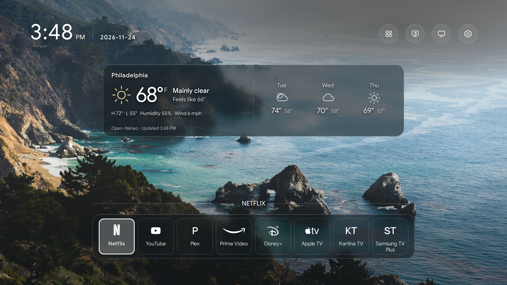

# XanderView

XanderView is a Samsung Tizen TV launcher forked from [CleanFrame](https://github.com/nthnclrk/CleanFrame) by Nathan Clark. It keeps a simple home screen for your apps, with a configurable weather widget and remote-friendly controls.



*Browser preview with example weather data.*

- Centered app dock with up to 10 square tiles per row and 20 apps in two rows.
- App discovery, reordering, TV Settings and Connected Devices shortcuts.
- Optional weather, location and temperature-unit settings, provided by Open-Meteo.
- Wallpaper gallery, fonts, layout and appearance settings.
- Optional Tizen 10 workaround that returns to XanderView when Samsung Home appears (see below).

The original CleanFrame copyright and MIT licence remain in [LICENSE](LICENSE). Fonts, photographs and logos have their own terms in [THIRD_PARTY_NOTICES.md](THIRD_PARTY_NOTICES.md) and [asset sources](docs/asset-sources.md). XanderView is independent of Samsung and the services whose marks appear here.

## Preview

Requires Node.js 22+ and Python 3.10+:

```sh
git clone https://github.com/xela19115/XanderView.git
cd XanderView
npm ci
npm run dev
```

Open `http://localhost:4795/home/`. Use arrow keys, Enter and Escape. Launching apps and Samsung menus requires a TV.

## Install on a Samsung TV

A `.wgt` must be signed with a Samsung developer certificate that includes the target TV's device ID. The release download is an **unsigned package**, ready to sign; it cannot be installed directly without this step. A package signed for somebody else's TV will generally not install on yours. This project does not publish anyone's signing keys or device certificates.

1. Install [Tizen Studio and the Samsung TV Extension](https://developer.samsung.com/smarttv/develop/getting-started/setting-up-sdk.html). Enable Developer Mode on the TV, configure the development computer's IP address, and restart the TV as required. See Samsung's [device connection instructions](https://developer.samsung.com/smarttv/develop/getting-started/using-sdk/tv-device.html).
2. Create a Samsung author and distributor certificate/profile for your TV in Certificate Manager. Include the TV's DUID in the distributor certificate. See [Samsung certificate instructions](https://developer.samsung.com/smarttv/develop/getting-started/setting-up-sdk/creating-certificates.html). Keep certificates and passwords private.
3. For your own installation, choose a unique ten-character alphanumeric package ID and run `python3 scripts/configure-identity.py YOURID1234`. This updates the app identity and its internal self references. Keep the same ID and author certificate for later updates.
4. Create and sign the package with the Tizen SDK's `tz` executable and your profile:

   ```sh
   python3 scripts/sign.py --tz /path/to/tizen-studio/tools/tizen-core/tz \
     --profiles /path/to/tizen-studio-data/profile/profiles.xml \
     --profile YOUR_PROFILE
   ```

   The result is `dist/XanderView.wgt`. Paths vary by operating system and SDK installation. The signing script regenerates the unsigned archive from the current source, including any identity change.
5. Connect the TV with Samsung's Device Manager or `sdb`, then install the signed widget using Tizen Studio or the Samsung SDK installation flow. Verify XanderView opens and remote navigation works. Firmware, permissions and app IDs vary across TV models; an installation command reporting success does not guarantee every shortcut works.

The project was used on two Samsung models, QN800B and QN990F, but the public build and its independent identity have not been physically tested on every TV. App shortcuts and connected-device menus may vary by model or region.

## Home button on Tizen 10

Samsung retains control of the physical Home button; ordinary apps cannot reliably remap it system-wide. XanderView includes an optional workaround: while the app remains running in the background, it detects Samsung Home becoming foreground and asks Tizen to reopen XanderView. Enable **Return to XanderView** in XanderView's Samsung settings after installation. It starts **off** for a new installation so the TV's normal Home remains available while you test.

This is a workaround, not a system-level remapping. It depends on firmware and background execution, may not work after a reboot or when the app is stopped, and can interrupt access to Samsung Home. Turn the setting off to stop it. XanderView pauses the workaround briefly when opening Samsung Settings or Connected Devices. Test those exits and keep the remote and normal recovery options available.

## Build and validate

```sh
npm run check
npx playwright install chromium
npm run check:dock
npm run check:browser
npm run package
```

`npm run package` creates `dist/XanderView-public-unsigned.wgt` plus its SHA-256 report. No paid fonts, credentials or device settings are included. The bundled 15 wallpapers are the credited original CleanFrame gallery; owners may replace these locally, subject to the images' licences.
