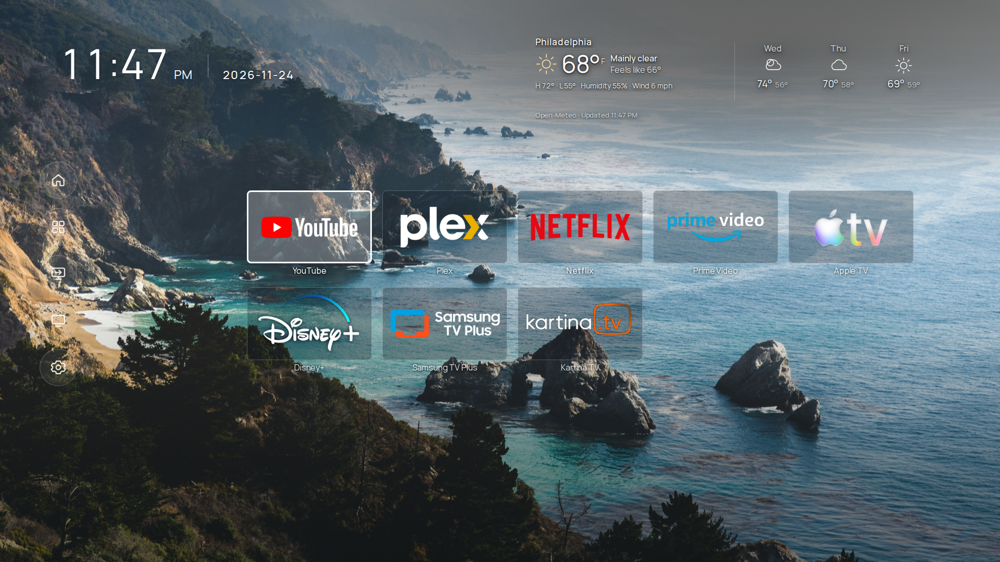
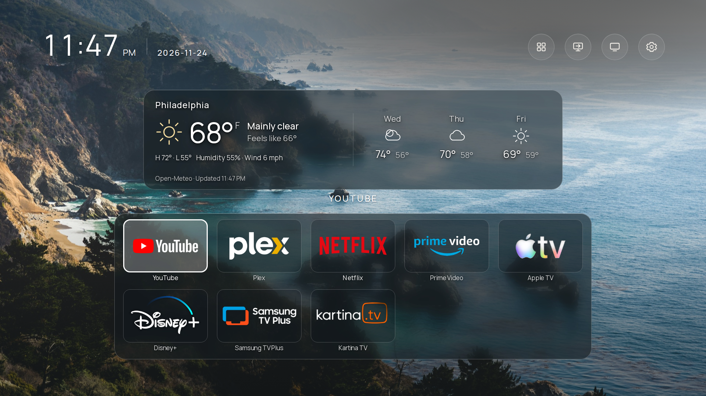

# XanderView

XanderView is a remote-friendly Samsung Tizen TV launcher, forked from [CleanFrame](https://github.com/nthnclrk/CleanFrame) by Nathan Clark. It combines two Home screens in one app: **Tiles**, a configurable grid, and **Dock**, a centered two-row launcher. Switch between them in **Settings → Layout → Home screen**.





*Browser previews with example weather and the optional Projectivy icons, which are downloaded separately during setup. Installed-app artwork varies by TV.*

## Features

- **Tiles:** left-aligned app grid with three, four or five tiles per row; cards resize automatically.
- **Dock:** two rows of five, with scrolling for additional selected apps.
- Shared apps, wallpaper, weather and appearance settings across both views. The selected Home screen is restored when the app opens.
- App icons, names or both; in Both mode names appear below the cards.
- Optional weather and forecast, with a configurable location and temperature units, provided by Open-Meteo.
- Fifteen original CleanFrame wallpapers, fonts, translucent cards and remote-friendly controls.
- Shortcuts for TV settings and connected devices. Availability and behavior vary by Samsung model and firmware.
- An optional Tizen 10 Home-return workaround, described below.

The built-in icons fall back to artwork exposed by the TV and bundled marks. The [Projectivy Icon Pack](https://github.com/SicMundus86/ProjectivyIconPack) can be downloaded locally during setup for matching YouTube, Plex, Netflix, Prime Video, Apple TV, Disney+ and HDHomeRun artwork. Kartina TV and Samsung TV Plus use the project owner's supplied artwork. Icons are not endorsements; their respective owners retain trademark rights.

An AI coding agent can also help customize backgrounds, fonts, tile shapes and colors in a local copy of the project.

## Preview

Requires Node.js 22+ and Python 3.10+:

```sh
git clone https://github.com/xela19115/XanderView.git
cd XanderView
npm ci
npm run dev
```

Open `http://localhost:4795/home/`. Use arrow keys, Enter and Escape, or click the controls. The browser preview has separate settings and cannot launch apps or Samsung menus on your TV.

## Install on a Samsung TV

Samsung requires a `.wgt` signed with your own Samsung developer certificate and a distributor certificate authorized for the target TV. The [release download](https://github.com/xela19115/XanderView/releases) is an **unsigned starter package**; it must be signed before installation. To include the optional Projectivy icons, use the source setup below and rebuild the package. The release download itself does not bundle those icons.

1. Install [Tizen Studio and the Samsung TV Extension](https://developer.samsung.com/smarttv/develop/getting-started/setting-up-sdk/installing-tv-sdk.html). Enable Developer Mode on the TV, enter your computer's IP address, and restart the TV as required. See [Samsung's device connection instructions](https://developer.samsung.com/smarttv/develop/getting-started/using-sdk/tv-device.html).
2. In Certificate Manager, create a Samsung author and distributor certificate profile for your TV, including its DUID in the distributor certificate. See [Samsung's certificate instructions](https://developer.samsung.com/smarttv/develop/getting-started/setting-up-sdk/creating-certificates.html). Keep certificates and passwords private.
3. Clone the source as shown above. Choose a unique ten-character alphanumeric package ID and configure it consistently for both views:

   ```sh
   python3 scripts/configure-identity.py YOURID1234
   ```

   Keep the same ID and author certificate for later updates. A different ID creates a separate installation.
4. **Optional — download the Projectivy icons.** The setup verifies a pinned APK checksum and extracts seven PNG resources; it never runs the Android app. The icons stay in an ignored local folder and are included in your personal signed build. The pack's source repository does not state a redistribution licence, so the public release does not include its icon files.

   ```sh
   python3 -m venv .venv
   . .venv/bin/activate
   python3 -m pip install -r requirements-icons.txt
   python3 scripts/install-icon-pack.py
   ```

5. Build and sign with the Tizen SDK's `tz` executable and your certificate profile:

   ```sh
   python3 scripts/sign.py --tz /path/to/tizen-studio/tools/tizen-core/tz \
     --profiles /path/to/tizen-studio-data/profile/profiles.xml \
     --profile YOUR_PROFILE
   ```

   This creates `dist/XanderView.wgt`. Paths vary by operating system and SDK installation. The signing script builds from your current source and includes the optional icons if you downloaded them.
6. Connect the TV using Samsung's Device Manager or `sdb` and install the signed widget using Tizen Studio. On the reference QN800B/QN990F, the following Samsung SDK commands were also used; replace the example address and app ID with your own:

   ```sh
   TV_IP=YOUR_TV_IP
   APP_ID=YOURID1234.XanderView
   sdb connect "$TV_IP:26101"
   sdb -s "$TV_IP:26101" push dist/XanderView.wgt /home/owner/share/tmp/sdk_tools/XanderView.wgt
   sdb -s "$TV_IP:26101" shell 0 vd_appinstall "$APP_ID" /home/owner/share/tmp/sdk_tools/XanderView.wgt
   sdb -s "$TV_IP:26101" shell 0 execute "$APP_ID"
   ```

   The SDK commands and TV paths may differ on other firmware. Check for a completed install and verify the screen and remote on the TV. Installing the app does not itself assign the physical Home button.

The personal combined launcher was tested on a Samsung QN800B, and earlier versions were used on QN800B and QN990F. The independent public build and identity have not been tested on every TV. App IDs, icons and connected-device menus can vary by model, region and firmware.

## Home button on Tizen 10

Samsung controls the physical Home button, and ordinary apps cannot reliably remap it system-wide. XanderView includes an optional workaround: while the app remains running in the background, it detects Samsung Home becoming foreground and asks Tizen to reopen XanderView. Enable **Return to XanderView** in **Settings → Samsung** after installing. It starts **off** for a new installation, so normal Samsung Home remains available while you test.

This workaround depends on firmware and background execution. It may not work after a reboot or when the app is stopped, and it can interrupt access to Samsung Home. Turn the setting off to stop it. The app pauses the workaround briefly when opening Samsung Settings or Connected Devices. Test those exits and retain your normal recovery options.

## Build and validate

```sh
npm run check
npx playwright install chromium
npm run check:layouts
npm run check:views
npm run check:dock
npm run check:browser
npm run check:public
npm run package
```

`npm run package` produces `dist/XanderView-public-unsigned.wgt` and a SHA-256 report. It intentionally excludes locally downloaded Projectivy icons. `scripts/sign.py` creates a separate personal build and includes those icons when present. Neither process requires copying signing keys into the repository.

## Licence and credits

XanderView is a fork of [CleanFrame](https://github.com/nthnclrk/CleanFrame); its original copyright and MIT licence are retained in [LICENSE](LICENSE). Fonts, photographs, app artwork and trademarks have their own terms; see [third-party notices](THIRD_PARTY_NOTICES.md) and [wallpaper credits](docs/asset-sources.md). The Projectivy pack is downloaded from its creator during optional setup and is not included in the public release.

XanderView is an independent project and is not affiliated with Samsung or the streaming services shown.
